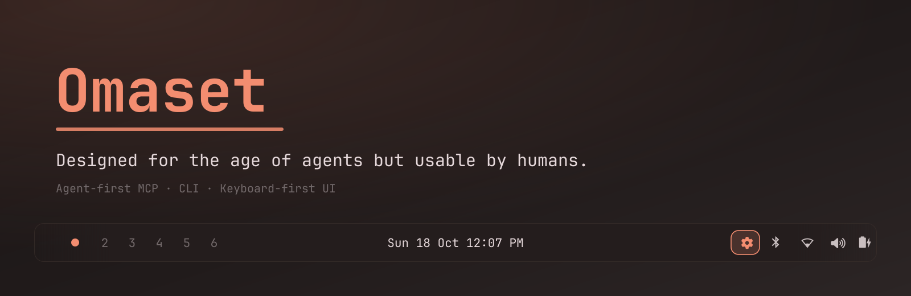
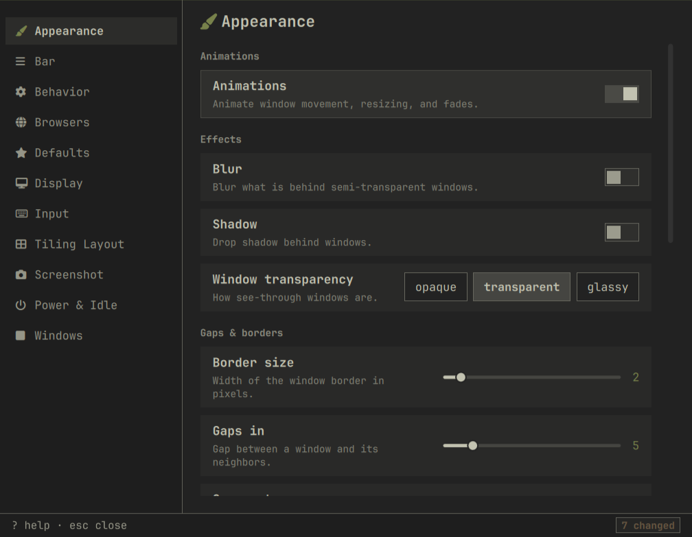
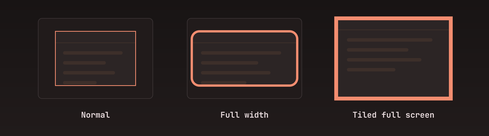
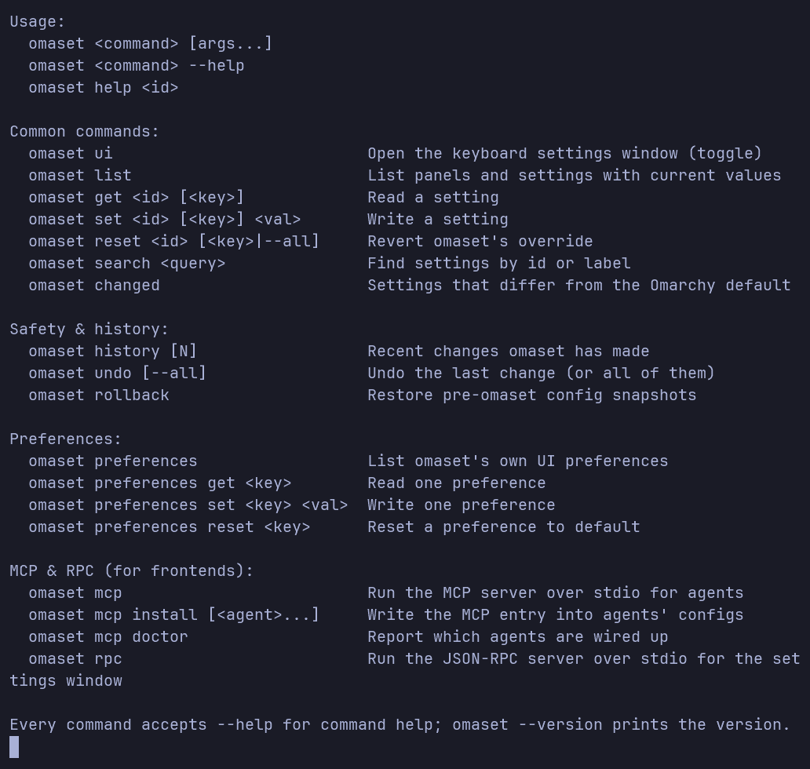

# Omaset

<p align="center">
  <a href="LICENSE"></a>
  
  
  
</p>

<p align="center">
  
</p>

Your config files are the source of truth. Omaset puts every setting within reach — of you, and of your agent. Update one value where it lives. Everything else stays as you left it. See what's changed. Take it back.

**Welcome the agents.** Your agent gets the same settings you do, as tools it can call. It searches for a setting by name, reads what it's set to, changes it. No parsing files, no guessing, no shell incantations — just the same settings, in front of both of you.

**Made for 4.5.** The new desktop is more familiar to people coming from Windows or macOS, used to a settings panel. Omaset does the same for settings — a view for humans, while your agent keeps working directly with the files.

**Speaks your language.** Every label, description, and option in all 50 Omarchy languages.

**Checked before it lands.** Every change is validated against the live config, and Omaset puts it back if Hyprland won't load. `changed` shows what's not stock, `history` shows how it got there.

**No magic numbers.** Your configuration file still says `300` — that's seconds to the computer. Omaset shows you `5 min` — that's how you think about it. Same for times and every other choice. Made readable for humans, not just machines.

<p align="center">
  
</p>

## Requirements

Omarchy 4.5+ (older Omarchy still works). Nothing else to install — engine, command line, and window ship as one plugin.

## Install

```sh
omarchy plugin add https://github.com/b2amedina/omaset.git --enable
```

Then link the command line and hook up your agent:

- [The CLI](docs/cli.md) — `ln -s …/bin/omaset ~/.local/bin/omaset`
- [For agents](docs/agents.md) — `omaset mcp install`

The bar widget is enabled automatically when you install with `--enable`
(default section: `centerEnd`, beside the clock). To apply a set of sensible
defaults (full-width and tiled full-screen styling, plus the bar widget on the
right if it is missing), run:

    scripts/omaset-defaults

Click the Omaset icon in your bar, or run `omaset ui`.

## What it manages

Covers appearance, layout, bar, input, windows, power, display, behavior, and default applications. One panel per area in the table below. [More backends](docs/backends.md) are added over time.

| Panel | Examples |
|---|---|
| Appearance | gaps, borders, rounding, blur, shadow, groupbar, corners, transparency |
| Tiling Layout | default layout, dwindle/scrolling/floating, scrolling width, dock |
| Bar | position, background |
| Input | mouse, trackpad, key repeat, numlock |
| Windows | full-width & tiled-fullscreen styles, single-window square |
| Power & Idle | screen and lock timeouts |
| Display | night light on/off, schedule (start & end), temperature |
| Omasnap | editor mode/window/backdrop, autosave, screenshot directory and filename pattern |
| Defaults | agent, browser, terminal, editor, dictation (as in Omarchy's Setup > Defaults) |
| Behavior | focus, tearing, cursor hiding |

## Why Omaset

- **One place to see it all.** Every panel, searchable.
- **Three ways in, same settings.** Agent, window, command line.
- **Checked before it lands.** Validation, then applied in place — nothing rewritten wholesale.
- **Styled to match.** Colors and shapes come from your theme.

<p align="center">
  
</p>

## How to use

**The window.** `omaset ui` opens a keyboard-first settings window. It uses the same core as the command line, so what you see is what the CLI sees.

| Key | Action |
|---|---|
| `j` / `k` (or `↑` / `↓`) | move between settings (or sidebar panels) |
| `h` / `l` (or `←` / `→`) | adjust the focused slider or cycle a segmented control |
| `Tab` / `Shift+Tab` | switch sidebar / content pane |
| `Space` / `Enter` | activate the focused row, or edit a slider/time value |
| `/` | search any setting |
| `c` | open the Changed list — what differs from stock |
| `p` | open Preferences |
| `x` | reset the focused setting to its default |
| `Esc` | close (or leave search / changed / preferences) |

Vim keys throughout — or the arrows. On a slider or time row, press `Enter`, type a value, press `Enter` again. `Esc` cancels. See [ui/README.md](ui/README.md) for the window in depth.

**The CLI.** Link the bundled binary onto your PATH:

```sh
ln -s ~/.config/omarchy/plugins/b2amedina.omaset/bin/omaset ~/.local/bin/omaset
omaset get gaps_in            # read one setting
omaset set gaps_in 8          # write one (validated, applied, journaled)
omaset changed                # what differs from stock
omaset undo                   # take it back
```

<p align="center">
  
</p>

Full command reference — keyed settings, `help`/`options`, and Omaset's own preferences — in [docs/cli.md](docs/cli.md).

## Documentation

| Page | What's in it |
|---|---|
| [Changelog](CHANGELOG.md) | what's new in each release |
| [How it works](docs/how-it-works.md) | the core, the schema, the three interfaces |
| [Backends](docs/backends.md) | how each area reads and writes its config |
| [Extending with Lua](docs/extending.md) | add a setting, or a whole backend |
| [The CLI](docs/cli.md) | commands, keyed settings, preferences |
| [Safety & undo](docs/safety.md) | in-place edits, `undo`, `rollback`, `reset` |
| [For agents](docs/agents.md) | the MCP server and a worked example |
| [Protocol](docs/protocol.md) | the machine-readable contract |
| [Internationalization](docs/i18n.md) | the catalogs, language resolution, and the per-release checklist |
| [Tests](docs/tests.md) | how Omaset is tested |
| [Settings UI](ui/README.md) | the Quickshell window, install and keys |

## Remove

```
omaset rollback
omarchy plugin remove b2amedina.omaset
unlink ~/.local/bin/omaset
```

Rolls back config files first (optional), then removes the plugin and the command link.

## How it fits together

One small core. A set of backends that all share a common interface, so the engine never needs to know the configuration details. Three ways in:

- **MCP for your agent** — the main one.
- **The window** — keyboard-first, uses Omarchy styling.
- **The command line** — `omaset get`, `set`, `changed`, `undo`.

Add a setting or a backend, and all three pick it up. That's the whole design.

## Next steps

- More backends.
