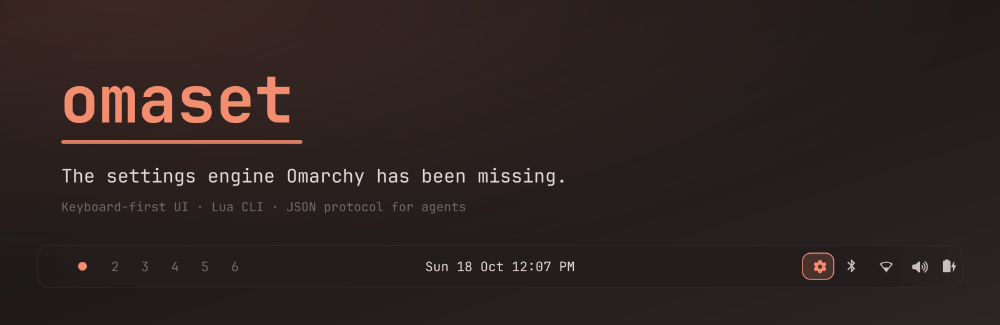
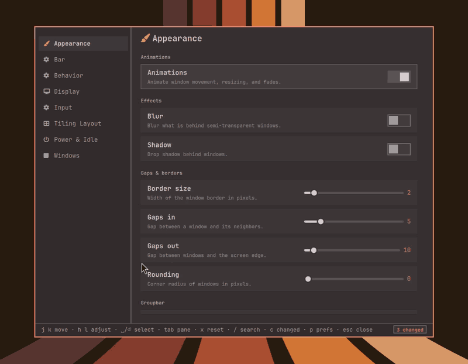
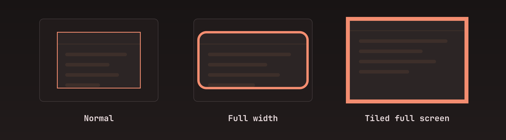
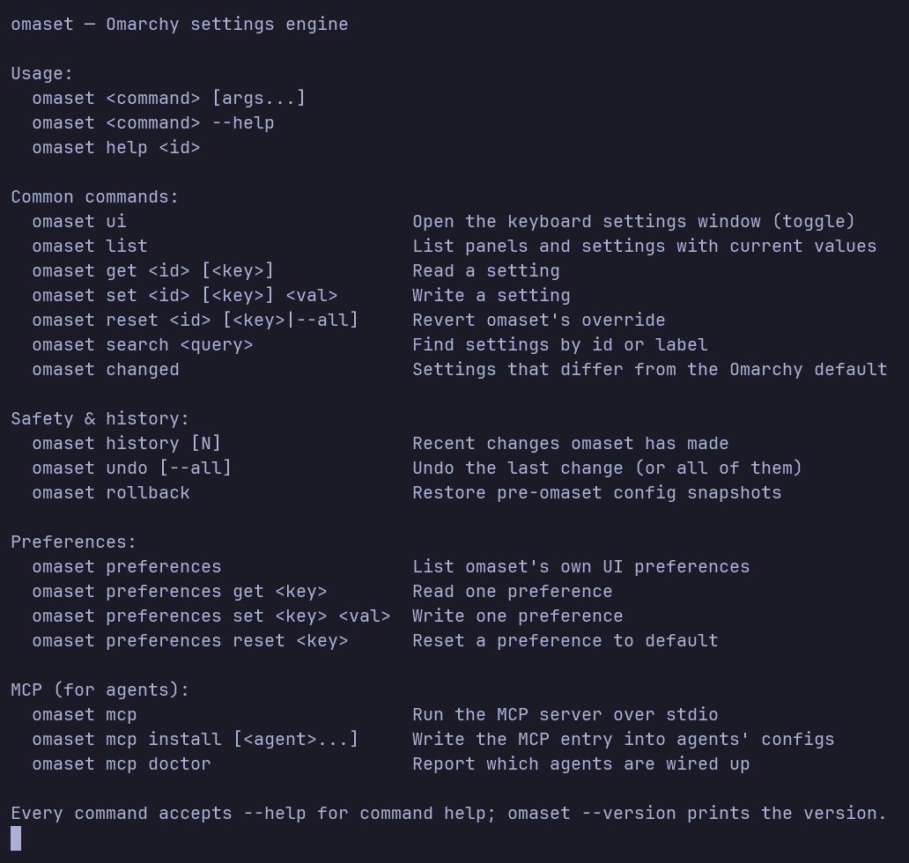
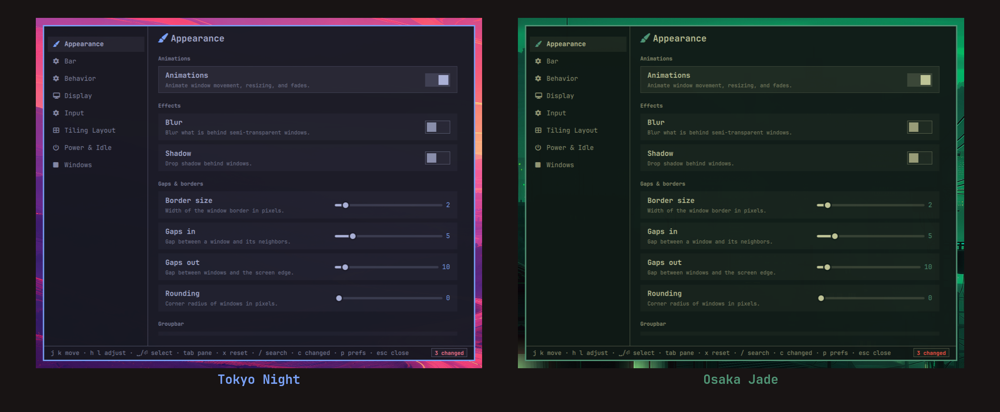

# omaset

> **A settings manager for Omarchy.**

<p align="center">
  <a href="LICENSE"></a>
  
  
  
</p>

<p align="center">
  
</p>

Omarchy's settings live in plain-text dotfiles — yours to read, version, and
edit. omaset puts a face on them: a keyboard-first UI, a scriptable CLI, and an
MCP server your agents can drive — so you can browse, search, and see what's
really in your config, without ever rewriting it.

<p align="center">
  
</p>

## Install

```sh
omarchy plugin add https://github.com/b2amedina/omaset.git --enable
```

The engine and CLI do the real work; the settings window is a convenience on
top. All three ship as one Omarchy plugin, so there is nothing separate to
install. Click the omaset icon in your bar, or run `omaset ui` once you
[link the CLI](docs/cli.md).

## What it manages

omaset models Omarchy's settings through small, pluggable **backends**, one per
area. The engine is deliberately backend-agnostic, so it can grow to cover more
of the operating system — and more backends are [being added](docs/backends.md) —
without any change to the core.

| Panel | Examples |
|---|---|
| Appearance | gaps, borders, rounding, blur, shadow, groupbar |
| Tiling Layout | default layout, dwindle/master options, scrolling width |
| Bar | position, transparency |
| Input | mouse, trackpad, key repeat, numlock |
| Windows | full-width & tiled-fullscreen styles, single-window square |
| Power & Idle | screen and lock timeouts |
| Display | night light on/off, schedule, temperature |
| Behavior | focus, tearing, cursor hiding |

## Why omaset

- **Every setting, one place.** Appearance, tiling layout, and more —
  browsable, searchable, and changeable in one window and one command, over the
  dotfiles you already have.
- **One engine, pluggable backends.** Each area is a small backend on a shared
  core, and everything speaks one plain JSON interface — so the window, the CLI,
  and agents are just different faces on the same settings. New areas plug in
  without touching the engine.
- **Agent-friendly.** An MCP server exposes settings as typed tools, so your
  agent can widen the gaps or toggle blur in-session — and every change lands in
  the same journal you can undo.
- **Safe by default.** Every change is validated before it lands and reverted
  automatically if it fails. omaset writes only into a marked block — it never
  rewrites your config — so your hand-written files stay intact.
- **Your config, made legible.** `changed` shows exactly what you've customized
  against stock; `history` shows how you got there. Your dotfiles stay readable
  at a glance, over time.
- **Styled to match — and made obvious.** Colors, borders, and shapes come from
  your active theme, so the window looks like it shipped with Omarchy, not a
  separate app. And you can give full-width and tiled-fullscreen windows their
  own border and rounding, so you can tell them apart at a glance:

<p align="center">
  
</p>

## How to use

**The window.** `omaset ui` opens a keyboard-first settings window that renders
`omaset schema` and drives `get`/`set`/`reset` — so it always reflects the same
settings the CLI does.

| Key | Action |
|---|---|
| `j` / `k` (or `↑` / `↓`) | move between settings (or sidebar panels) |
| `h` / `l` (or `←` / `→`) | adjust the focused slider or cycle a segmented control |
| `Tab` / `Shift+Tab` | switch sidebar / content pane |
| `Space` / `Enter` | activate the focused row, or open one from a list |
| `/` | search any setting |
| `c` | open the Changed list — what differs from stock |
| `p` | open Preferences |
| `x` | reset the focused setting to its default |
| `Esc` | close (or leave search / changed / preferences) |

Vim keys throughout — `h` `j` `k` `l` — or the arrow keys; the mouse is
optional.

The footer shows these hints plus a contextual badge — `N changed` when settings
differ from stock, `N settings found` while searching. See
[ui/README.md](ui/README.md) for the window in depth.

**The CLI.** Link the bundled binary onto your PATH:

```sh
ln -s ~/.config/omarchy/plugins/b2amedina.omaset/bin/omaset ~/.local/bin/omaset
omaset get gaps_in            # read one setting
omaset set gaps_in 8          # write one (validated, applied, journaled)
omaset changed                # what differs from stock
omaset undo                   # take it back
```

<p align="center">
  
</p>

Full command reference — keyed settings, `help`/`options`, and omaset's own
preferences — in [docs/cli.md](docs/cli.md).

## Documentation

| Page | What's in it |
|---|---|
| [How it works](docs/how-it-works.md) | the engine, the schema DSL, the JSON interface |
| [Backends](docs/backends.md) | how each area reads and writes its config |
| [Extending with Lua](docs/extending.md) | add a setting, or a whole backend |
| [The CLI](docs/cli.md) | commands, keyed settings, preferences |
| [Safety & undo](docs/safety.md) | managed blocks, `undo`, `rollback`, `reset` |
| [For agents](docs/agents.md) | the MCP server and a worked example |
| [Protocol](docs/protocol.md) | the machine-readable contract |
| [Tests](docs/tests.md) | how omaset is tested |
| [Settings UI](ui/README.md) | the Quickshell window, install and keys |

Themes are Omarchy themes: the window picks up your active one, so it looks at
home in Tokyo Night, Osaka Jade, or any theme you install.

<p align="center">
  
</p>

## Remove

```
omaset rollback                      # optional: restore config files omaset touched
omarchy plugin remove b2amedina.omaset
unlink ~/.local/bin/omaset           # only if you linked the CLI
```

`omarchy plugin remove` deletes the plugin folder; the CLI symlink is yours to
unlink. omaset's own state is left in place — the change journal
(`~/.local/state/omaset/journal.jsonl`), preferences
(`~/.config/omaset/preferences.json`), and any `<file>.omaset.bak` snapshots.

## Next steps

- A backup picker / restore view.
- Live previews (compositor/tiling/fullscreen) in the settings window.
- More backends — extending coverage across the OS and its applications.
