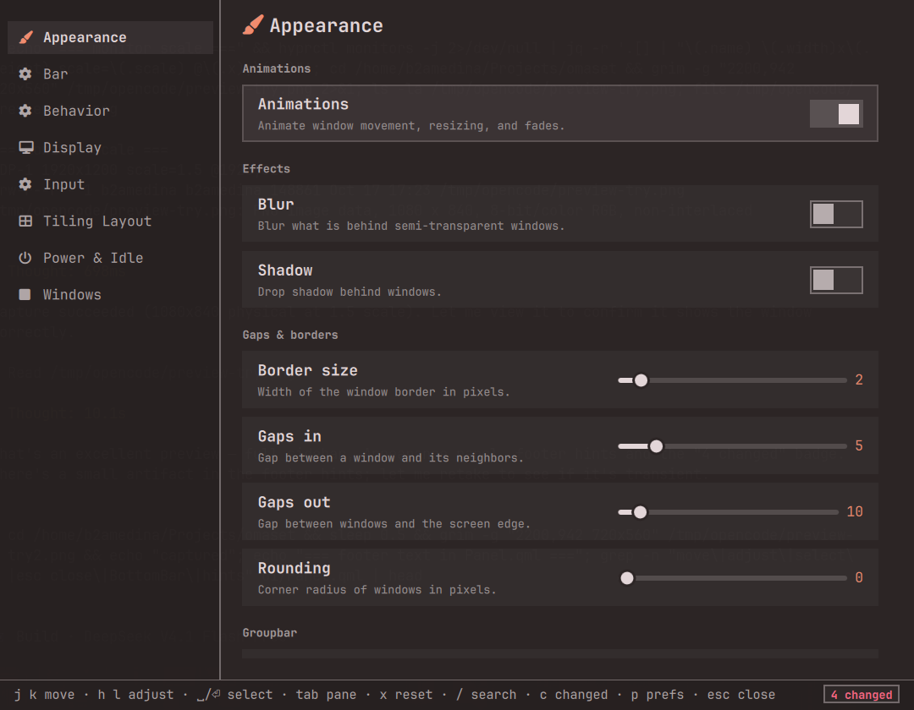

# omaset

> **The settings engine Omarchy has been missing.**

omaset gives every Omarchy setting one place to live: a keyboard-first
window, a plain-text CLI, and an MCP server your agents already speak. No
more hand-editing dotfiles or hunting down scattered `omarchy` commands —
change anything (gaps, blur, bar position, layouts, night light, window
styles) from one place, and stay safe with a journal, undo, and
one-command rollback. It never rewrites your config, and it renders in
whatever theme you're running, so it feels like part of Omarchy rather
than a bolt-on.

<p align="center">
  
</p>

## Why omaset

- **One place to change everything.** No more hand-editing dotfiles or
  memorizing scattered `omarchy` commands — appearance, tiling layout,
  bar, input, windows, and power all live in one window, one command, and
  one protocol.
- **Agent-friendly.** An MCP server exposes settings as typed tools, so
  your agent can widen the gaps or toggle blur in-session — and every
  change lands in the same journal you can undo.
- **Safe by default.** omaset writes only into a marked block in each
  file, validates with `hyprctl configerrors`, and reverts on failure.
  Your hand-written config is never touched.
- **Defaults that follow Omarchy.** `reset` recomputes the stock default
  on every call, so "back to default" always means what Omarchy ships —
  even after an update.
- **Styled to match.** Colors, borders, and shapes come from your active
  theme, so the settings window looks like it shipped with Omarchy, not
  a separate app.
- **Make window modes obvious.** Give full-width and tiled-fullscreen
  windows their own border and rounding, so you can tell them apart at a
  glance instead of guessing how a window will behave.

## What it manages

omaset models the settings Omarchy hands you today — the compositor, the
bar, night light, and per-workspace layouts — each through a small,
pluggable **backend**. The engine is deliberately backend-agnostic, so it
can grow to cover more of the operating system and the applications on
top of it without any change to the core.

| Panel | Examples |
|---|---|
| Appearance | gaps, borders, rounding, blur, shadow, groupbar |
| Tiling Layout | default layout, dwindle/master options, scrolling width |
| Bar | position, transparency |
| Input | mouse, trackpad, key repeat, numlock |
| Windows | full-width & tiled-fullscreen styles, single-window square |
| Power & Idle | screen and lock timeouts |
| Display | night light on/off, schedule, temperature |
| Behavior | focus, tearing, cursor hiding |

## Install

The settings window and its engine ship together as an Omarchy shell
plugin:

```
omarchy plugin add https://github.com/b2amedina/omaset.git --enable
```

This clones the plugin into `~/.config/omarchy/plugins/b2amedina.omaset/`
and enables it. The engine is bundled inside that folder — there is
nothing else to install; it uses only the `lua5.1` interpreter and `jq`
that vanilla Omarchy already ships. Open the window with `omaset ui`
(toggle) or `omarchy-shell shell toggle b2amedina.omaset '{}'`.

The `omaset` CLI is optional: link the bundled binary onto your PATH if
you want to drive settings from a terminal or an agent (see
[For agents](#for-agents)):

```
ln -s ~/.config/omarchy/plugins/b2amedina.omaset/bin/omaset ~/.local/bin/omaset
```

**Status:** engine + CLI + keyboard-first UI (`omaset ui`) + MCP server.

## Remove

```
omaset rollback                      # optional: restore config files omaset touched
omarchy plugin remove b2amedina.omaset
unlink ~/.local/bin/omaset           # only if you linked the CLI
```

`omarchy plugin remove` deletes the plugin folder; the optional CLI symlink is
yours to unlink. omaset's own state is left in place — the change journal
(`~/.local/state/omaset/journal.jsonl`), preferences
(`~/.config/omaset/preferences.json`), and any `<file>.omaset.bak` snapshots.

## Usage

```
bin/omaset list [--json]              # panels + settings with current values
bin/omaset schema                     # full schema as JSON (what a UI renders)
bin/omaset get <id> [--plain]         # read one setting
bin/omaset set <id> <val> [--plain]   # write a value; validates + applies
bin/omaset reset <id> [--plain]       # restore a setting to its default
bin/omaset changed [--json]           # settings that differ from defaults
bin/omaset search <query> [--json]    # find settings by id or label
bin/omaset help <id>                  # one setting's type/options/default/current
bin/omaset keys <id>                  # list keys of a keyed setting (workspaces)
bin/omaset ui [open|close|toggle|reload]  # open the keyboard settings window (toggle)
bin/omaset history [--json] [N]       # recent changes omaset has made
bin/omaset undo [--all] [--plain]     # undo the last change (or all of them)
bin/omaset rollback [--json]          # restore pre-omaset config snapshots
bin/omaset preferences [list|get|set|reset]  # omaset's own UI preferences
bin/omaset mcp                        # MCP server over stdio (for agents)
bin/omaset mcp install [<agent>...]   # wire the server into agents' configs
bin/omaset mcp doctor                 # report which agents are wired
bin/omaset --version
```

Keyed settings take a subject argument, e.g.
`omaset get workspace_layout 2` / `omaset set workspace_layout 3 scrolling`.

To see what values a setting accepts, use `omaset help <id>` (lists `options`
for enums, `min..max` for numbers) or `omaset set <id> --help`, which shows the
`<a|b|c>` form. An invalid enum value lists the valid options in the error.

The engine runs in place — no build step — using only the `lua5.1` interpreter
and `jq` that vanilla Omarchy already ships.

## Settings window

`omaset ui` opens a keyboard-first settings window (an Omarchy Quickshell
plugin). It renders `omaset schema` and drives `get`/`set`/`reset`, so it
always reflects the same settings the CLI does. See
[ui/README.md](ui/README.md) for install and keybindings.

## Protocol

The JSON output of `schema`/`get`/`set`/`reset`/`changed`/`search` is the
machine-readable contract — see [docs/protocol.md](docs/protocol.md).

## For agents

omaset is built so an AI agent can drive Omarchy's settings through one JSON
interface instead of editing dotfiles by hand. See
[docs/agents.md](docs/agents.md) for the commands, a worked example, and the
safety model.

## MCP server

`omaset mcp` runs a zero-dependency [Model Context Protocol](https://modelcontextprotocol.io)
server over stdio, exposing omaset's settings as typed tools — so Claude Code,
Codex, opencode, Gemini, or Copilot can discover, read, and change settings in
session without shelling out to the CLI.

```
omaset mcp install               # wire the server into every supported agent
omaset mcp install claude opencode  # or name the agents you use
omaset mcp doctor                # verify which agents point at the server
```

Tools: `schema`, `search`, `get`, `set`, `reset`, `changed`, `help`, `keys`,
`undo`, `open_ui` (the client namespaces them as `omaset_<tool>`, so the double
`omaset_omaset_` prefix never appears). Every write goes through the same
validation and journal as the CLI, so agent changes are visible in
`omaset history` and undoable.

## Safety, undo & rollback

omaset never parses-and-rewrites your files. It only writes into a marked
`-- omaset:begin/end` block (Lua config) or via Omarchy's own `jq` pipeline
(`shell.json`), and keeps a one-time `<file>.omaset.bak` snapshot before its
first write to any config file. Hyprland Lua config writes are re-validated
with `hyprctl configerrors` and automatically reverted on failure.

- `omaset history` lists every change omaset has made, oldest first, from an
  append-only journal at `~/.local/state/omaset/journal.jsonl`.
- `omaset undo` undoes the most recent change; `undo --all` replays the journal
  in reverse. Undo restores the recorded previous value, and falls back to
  `reset` when the setting was previously untouched (so "back to default" keeps
  following the Omarchy default rather than pinning a value).
- `omaset rollback` is the panic button: it restores every `<file>.omaset.bak`
  snapshot for each file-writing backend, returning each config file to the
  state it had before omaset first wrote to it. It does not depend on the
  journal.

## Reset & changed semantics

`reset` reverts **omaset's override** — it removes what omaset wrote and lets
the Omarchy stock default re-emerge. It does not store snapshots: `read_default`
recomputes the default from Omarchy's shipped config on every call.

- `changed` diffs the *effective* value (as read from your config) against that
  stock default, so it sees changes made by hand-editing, `omarchy` commands, or
  hotkeys too. In the settings window, press `c` to open a "Changed" list of
  every differing setting (value → default); Enter jumps to it.
- A setting can declare its own `default` when the backend cannot recompute
  one — the `omarchy` passthrough toggles (`nightlight`, `window-no-gaps`,
  `single-window-square`) declare `default = false` so they participate in
  `changed` too.
- `hypr-lua` writes into a managed `-- omaset:begin/end` block, so `reset` only
  removes omaset's block. A hand-written `hl.config(...)` override elsewhere in
  the file is left alone (and would take effect again). To restore *everything*
  to stock, use `omarchy refresh hyprland`.
- `workspace-layout` shares storage with `omarchy hyprland workspace layout
  toggle` (Super+L) — the same `~/.local/state/omarchy/workspace-layouts/*.lua`
  files — so the two are coherent. `reset workspace_layout <n>` deletes one
  rule; `reset workspace_layout --all` clears every persisted rule, including
  workspaces that are not currently open.

## Preferences

omaset also has a few settings about *itself*, kept separate from the Omarchy
settings above. They live in `~/.config/omaset/preferences.json`, are managed
with `omaset preferences`, and are **not** Omarchy settings: they never appear
in the settings panels, `search`, or `changed`.

- `refresh_interval_sec` — how often the settings window re-reads values while
  visible (default 2, range 1..60).
- `launch_floating` — whether the window opens floating (default true). omaset
  manages this by adding/removing a `o.window(... float/center ...)` rule for
  its own window in the managed block of `~/.config/hypr/hyprland.lua`, so no
  hand-written rule is needed. Takes effect on the next open.

Edit them from the settings window with `p`, or from the CLI:

```
omaset preferences                            # list
omaset preferences get refresh_interval_sec   # read one
omaset preferences set refresh_interval_sec 5 # write one
omaset preferences reset launch_floating      # back to default
```

## Tests

```
tests/run.sh
```

Black-box tests that drive `bin/omaset` against fixture configs (via
`OMARCHY_PATH`, `OMASET_HYPR_DIR`, `OMASET_SHELL_CONFIG`, `OMASET_NO_APPLY`),
so they never touch the real system. They assert on the public CLI only — safe
to run while refactoring internals.

## How it works

```
bin/omaset              CLI entry (sets up package.path); `omaset ui` opens the window
lib/omaset/
  init.lua              registry + schema + command dispatch
  dsl.lua               panel()/section()/setting() declarative DSL
  discovery.lua         loads share/settings/*.lua (and ~/.config/omaset/settings/)
  types.lua             int/float/bool/enum coercion + range checks
  mcp.lua               MCP server (JSON-RPC over stdio) + agent registration
  json.lua              minimal JSON encoder + decoder (journal, preferences)
  journal.lua           append-only change log for history/undo
  preferences.lua       omaset's own UI preferences (separate from settings)
  util.lua              deep merge/get/set, serializer, shell helpers
  backends/             pluggable backends (self-register via load_dir)
    hypr_lua.lua         reads/writes Hyprland Lua config (looknfeel.lua etc.)
    hypr_window.lua      reads/writes o.window() rules (window indicators)
    shell_json.lua       reads/writes ~/.config/omarchy/shell.json via jq
    omarchy.lua          delegates to an existing omarchy command
    workspace_layout.lua per-workspace layout (keyed by workspace number)
    hyprsunset.lua       night light schedule (hyprsunset.conf)
share/settings/         built-in panels (appearance, layout, input, behavior,
                        bar, power, display, windows)
ui/                     the keyboard-first settings window (Quickshell plugin)
```

### The `hypr-lua` backend

- **Read** evaluates the default config (`$OMARCHY_PATH/default/hypr/`) then
  the user config (`~/.config/hypr/`), capturing every `hl.config()` call into
  one merged table — the same order-of-precedence Hyprland itself uses.
- **Write** maintains a single `-- omaset:begin` / `-- omaset:end` block at the
  end of the user file. Only keys changed through omaset live there; the rest
  of your file is never touched. A `.omaset.bak` snapshot is kept on first edit.
- **Validate** after every write with `hyprctl reload` + `hyprctl configerrors`;
  on errors the previous content is restored. Set `OMASET_NO_APPLY=1` to skip
  this (tests, headless).

### The `hypr-window` backend

- Manages `o.window(match, rules)` window rules (Omarchy's own helper) in a
  `-- omaset:begin` / `-- omaset:end` block inside `~/.config/hypr/hyprland.lua`,
  with the same write/validate/revert behaviour as `hypr-lua`.
- Each setting is a **group**: it declares a `match` and named `subsettings`
  (e.g. `border_size`, `rounding`). Sub-settings sharing a `match` compose into
  a single rule. `reset <id> <sub>` drops one field; `reset <id> --all` removes
  the whole rule, so the base `border_size`/`rounding` apply again.
- Defaults are declared in the DSL (there is no Omarchy stock window rule to
  read), so `changed` compares against those declared defaults. This is what
  powers the window-mode styles above: give full-width or tiled-fullscreen
  windows a distinct border and rounding so they are easy to identify.

### The `shell-json` backend

- Edits `~/.config/omarchy/shell.json` with `jq`, using the same
  normalize-and-commit approach as Omarchy's own `omarchy-shell-config`, so the
  file keeps its `version`/`bar`/`plugins` shape.
- **Read** merges defaults (`$OMARCHY_PATH/config/omarchy/shell.json`) with the
  user file; **write** is atomic (temp + `mv`) and hot-reloads the running
  shell. Requires `jq` (present on Omarchy).

### The `hyprsunset` backend

- Manages a single omaset-owned night profile (`time` + `temperature`) in a
  `# -- omaset:begin` / `# -- omaset:end` block inside
  `~/.config/hypr/hyprsunset.conf`, so the user's own profiles and comments are
  never touched.
- Exposes two settings: `schedule` (whether the night profile is active) and
  `temperature` (its color temperature in Kelvin, default 4000). Writing the
  temperature creates the profile if it does not exist; resetting the schedule
  removes the block entirely.
- Keeps a `<file>.omaset.bak` snapshot before its first write, so `rollback`
  restores the original `hyprsunset.conf` like the other file-writing backends.

### Extending with Lua

A setting file is just this:

```lua
panel("appearance", "Appearance", function()
  setting({
    id = "gaps_in",
    type = "int",
    label = "Gaps in",
    backend = "hypr-lua",
    file = "looknfeel",
    path = "general.gaps_in",
    min = 0, max = 30,
  })
end)
```

Related settings can be grouped under a presentational header with `section`
(it only affects ordering/labels in the UI — storage and defaults are
unchanged):

```lua
section("Groupbar", function()
  setting({ id = "groupbar_height", type = "int", label = "Groupbar height",
    backend = "hypr-lua", file = "looknfeel", path = "group.groupbar.height",
    min = 0, max = 100 })
  -- ...
end)
```

Within a panel, settings are sorted alphabetically by id, with each section's
settings kept contiguous (sections ordered by their first member). Drop a file
in `~/.config/omaset/settings/` to add a setting, or redefine a built-in id to
override it.

## Next steps

- A backup picker / restore view.
- Live previews (compositor/tiling/fullscreen) in the settings window.
- More backends — extending coverage across the OS and its applications.
